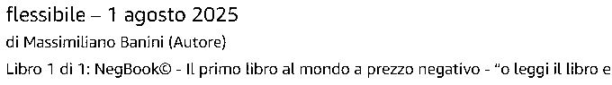
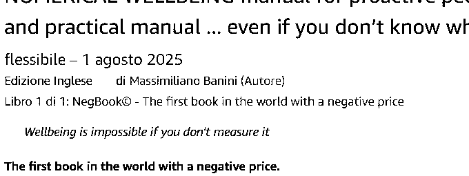
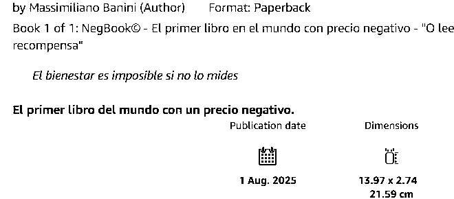

# Evidenze Amazon del NegBook — 1° agosto 2025

**Tre immagini pubblicate.** Sono **estratti in bianco e nero** delle schermate Amazon delle edizioni italiana, inglese e spagnola fornite da Massimiliano Banini. L'estratto spagnolo **accosta due ritagli della stessa schermata**, per rendere leggibili in un unico file l'autore e il claim nella parte alta e la data di pubblicazione riportata nella parte bassa.

| Edizione | Immagine | ASIN | Data mostrata nella schermata |
| --- | --- | --- | --- |
| Italiano | [Apri PNG IT](evidenza_negbook_IT_2025.png) | `B0FKZZH32D` | **1 agosto 2025** |
| English | [Open PNG EN](evidenza_negbook_EN_2025.png) | `B0FKZYMZZN` | **1 August 2025** |
| Español | [Abrir PNG ES](evidenza_negbook_ES_2025.png) | `B0FL115SBS` | **1 agosto 2025** |

## Estratto italiano

## English excerpt

## Extracto español

## Provenienza e limiti

Le **schermate a colori** sono state fornite dall'autore l'8 novembre 2026. Gli estratti GitHub sono stati creati a partire da quelle immagini mediante **ritaglio e conversione in bianco e nero**; lo spagnolo comprende due porzioni **della stessa schermata** disposte insieme, senza riscrivere il testo e senza inventare date. Questi file non rappresentano una cattura originale integrale del sito.

**«1 agosto 2025» indica la data di pubblicazione riportata dalle schede Amazon**, non la data di acquisizione delle schermate né la data del commit GitHub. I riferimenti alle opere sono nella [cronologia del NegBook](../PRIME-EDIZIONI-NEGBOOK-2025.md). Le copie integrali a colori non sono state pubblicate in questa cartella.

[Prime edizioni e ASIN](../PRIME-EDIZIONI-NEGBOOK-2025.md) · [Bibliografia e progetti](../fonti/libri-e-progetti.md) · [About Massimiliano Banini](../ABOUT-MASSIMILIANO-BANINI.md).
